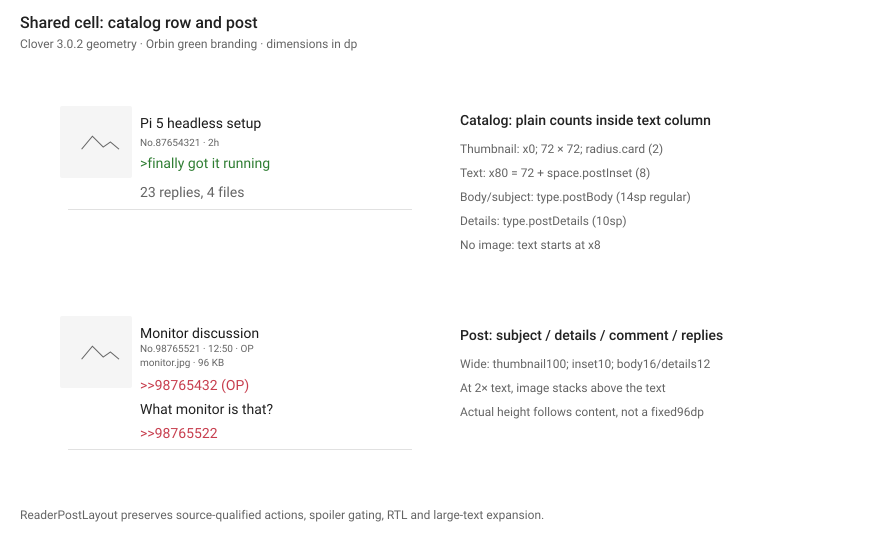
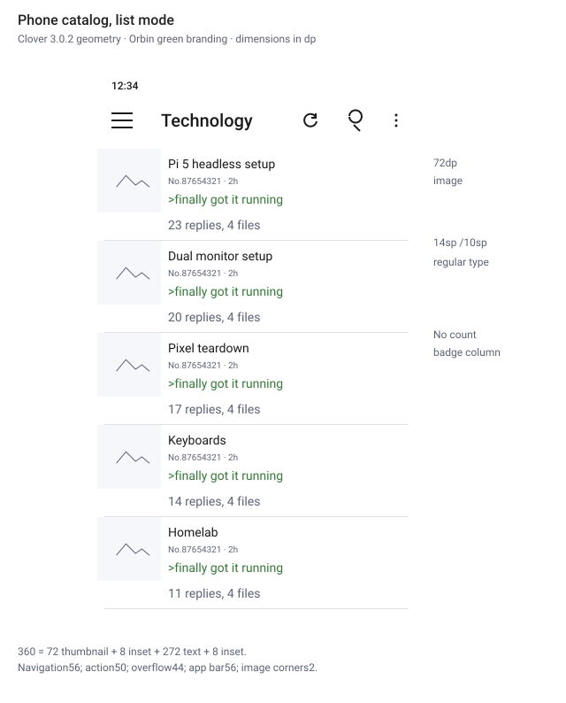
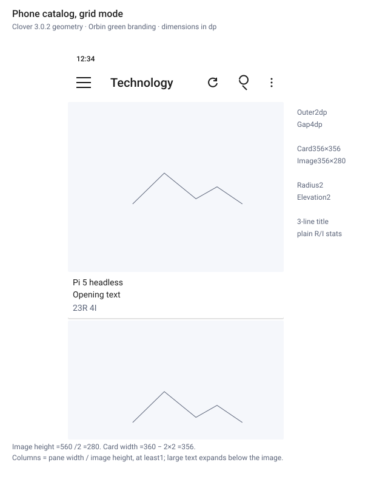
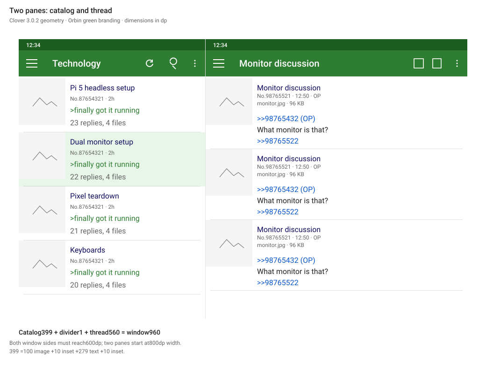
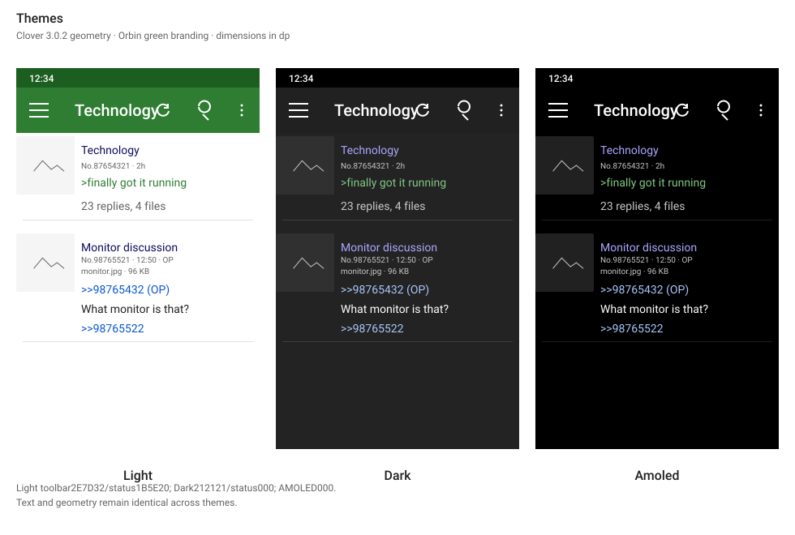
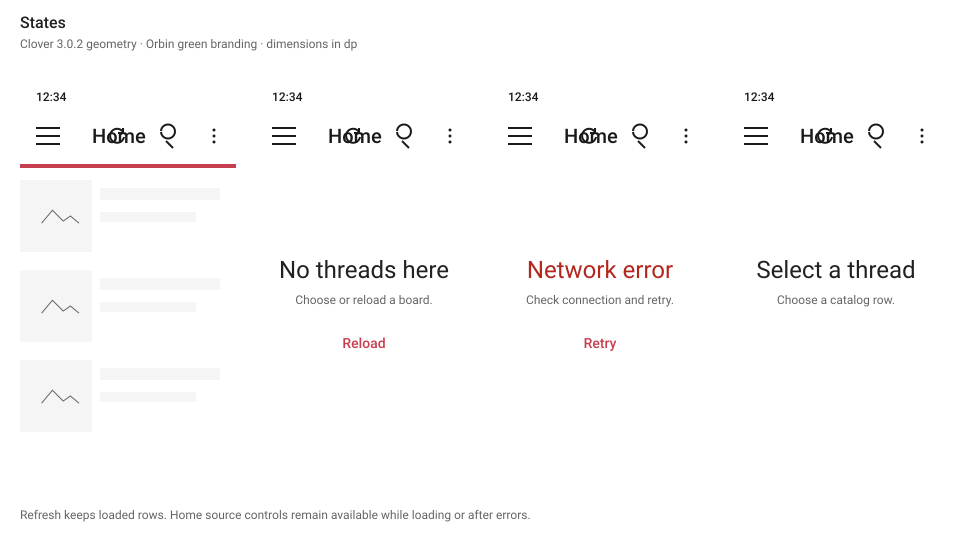

# Orbin reader design

This is the normative design for Orbin's Home, board catalog and thread reader. **Android and iOS share this implementation.** Implementation links, automated checks, screenshot and profile status, and the device checklist are tracked in [Implementation and verification](IMPLEMENTATION.md). That record distinguishes code being present from a passing check or a shipped release.

The Orbin Coral design is the visual specification for chrome, color, cards and navigation. Clover 3.0.2 remains the reference for compact reader geometry, typography and spacing. Orbin retains its name, coral ring icon and coral brand accent, together with its board subscriptions, sources, saved/watch tools and video playback. Orbin-specific functions use the same visual structures; unavailable Clover posting functions are not synthesized. [Source record](#source-record) identifies the exact APK and the verified design evidence.

A visual companion, [schematic.html](schematic.html), shows the same diagrams and tokens on one page. If the page and this document ever differ, this document is correct.

## Scope

Covered here:

- Home in list mode and grid mode, including source selection;
- the board catalog in list mode and grid mode;
- the thread reader;
- the two-pane layout that shows both;
- loading, empty and error states;
- light, dark and AMOLED themes.

Orbin is read-only. This design has no compose button, no reply box and no per-post reply control, and none may be added under it.

Home uses the same reader cells, List/Grid modes and theme colors as the board catalog. Saved uses a compact reader list of real stored records. Watched, Search and Settings take this design's frame and colors; [Other screens](#other-screens) says how. The media viewer keeps its dedicated playback experience.

## Tokens

The shared ReaderTokens implementation records the values below. Clover's verified geometry and neutral Light/Dark/Black surfaces define the reader metrics; Orbin's coral brand and contrast-safe action/link colors are intentional adaptations. Layout uses dp and type uses sp. Eight-digit colors use Android ARGB order (#AARRGGBB); SVG/CSS equivalents preserve the same alpha.

### Color

App-bar titles and icons use `color.onAppBar` over `color.appBar`; the status-bar ground uses `color.statusBar`.

| Token | Light | Dark | AMOLED | Use |
| --- | --- | --- | --- | --- |
| `color.appBar` | `#FFFFFF` | `#1C1C1E` | `#000000` | App bar ground |
| `color.statusBar` | `#FFFFFF` | `#000000` | `#000000` | Status bar ground |
| `color.onAppBar` | `#1A1A1A` | `#FFFFFF` | `#FFFFFF` | App bar labels and icons |
| `color.background` | `#FFFFFF` | `#1C1C1E` | `#000000` | Screen, row, post and card ground |
| `color.surfaceVariant` | `#F5F5F5` | `#2C2C2E` | `#212121` | Secondary ground, placeholders and skeletons |
| `color.selected` | `#FFF5F6` | `#3D2A2D` | `#3D2A2D` | Open row in two panes |
| `color.ink` | `#DE000000` | `#FFFFFF` | `#FFFFFF` | Primary body text |
| `color.inkSecondary` | `#89000000` | `#B2FFFFFF` | `#B2FFFFFF` | Generic secondary UI text |
| `color.inkMuted` | `#646464` | `#C5C8C6` | `#C5C8C6` | Post numbers, dates and attachment details |
| `color.hairline` | `#1E000000` | `#1EFFFFFF` | `#1EFFFFFF` | Decorative row and post dividers |
| `color.accent` | `#C73E4E` | `#FF8A96` | `#FF8A96` | Orbin progress and actions |
| `color.onAccent` | `#FFFFFF` | `#3B0D14` | `#3B0D14` | Text on an accent-filled control |
| `color.quote` | `#2E7D32` | `#81C784` | `#81C784` | Quoted lines |
| `color.author` | `#1A1A1A` | `#FFB0B8` | `#FFB0B8` | Post author name |
| `color.subject` | `#1A1A1A` | `#FFB0B8` | `#FFB0B8` | Post and catalog subjects |
| `color.quoteLink` | `#C73E4E` | `#FF9AA5` | `#FF9AA5` | Post references and backlinks |
| `color.error` | `#B3261E` | `#F2B8B5` | `#F2B8B5` | Error titles |

The light toolbar is white with dark ink so the coral logo and accent can carry the brand. color.statusBar matches color.appBar in Light, and is black in Dark and AMOLED. Dark uses a #1C1C1E toolbar; AMOLED uses black for both the toolbar and the status bar. Generic color.inkSecondary is distinct from color.inkMuted post metadata. Selected rows use a light coral wash #FFF5F6 in Light and a deep coral-tinted #3D2A2D in Dark and AMOLED. Subjects and author names use dark ink in Light and a light coral #FFB0B8 in Dark, so they stay readable on the selected ground. Post references use the coral accent. Quoted (greentext) lines keep a contrast-safe green. The supplied Clover fresh-install Yotsuba palette is recorded under Source record; it is not Orbin's selected palette.

### Contrast

The following pairs are checked after compositing alpha over the stated ground. Decorative color.hairline has no text-contrast minimum.

| Foreground | Background | Minimum ratio |
| --- | --- | --- |
| `color.onAppBar` | `color.appBar` | 4.5 |
| `color.onAppBar` | `color.statusBar` | 4.5 |
| `color.ink` | `color.background` | 4.5 |
| `color.inkSecondary` | `color.background` | 4.5 |
| `color.inkMuted` | `color.background` | 4.5 |
| `color.ink` | `color.surfaceVariant` | 4.5 |
| `color.inkMuted` | `color.surfaceVariant` | 4.5 |
| `color.ink` | `color.selected` | 4.5 |
| `color.inkMuted` | `color.selected` | 4.5 |
| `color.quote` | `color.background` | 4.5 |
| `color.quote` | `color.selected` | 4.5 |
| `color.subject` | `color.background` | 4.5 |
| `color.subject` | `color.selected` | 4.5 |
| `color.author` | `color.background` | 4.5 |
| `color.quoteLink` | `color.background` | 4.5 |
| `color.error` | `color.background` | 4.5 |
| `color.accent` | `color.background` | 3.0 |
| `color.onAccent` | `color.accent` | 4.5 |

### Type

Both platforms use bundled Roboto for the reader and shared default-family text. The exact open-source Medium, Medium Italic and Condensed Regular faces from the reference are retained; Regular/Bold/Italic variants are pinned to the actual API31 reference-runtime system Roboto because Clover delegates those faces to Android's system sans. See the packaged font provenance and Apache 2.0 notice in ui-next/src/commonMain/composeResources/files/licenses/. Natural line height means the font's metrics, with no invented fixed sp line height. Platform TextView/Compose baseline differences remain subject to native screenshot verification. The SVG diagrams embed diagram-only glyph subsets with the same original outlines and metrics; the application font assets remain complete and unmodified.

| Token | Size | Line height | Weight | Use |
| --- | --- | --- | --- | --- |
| `type.appBarTitle` | 20sp | 28sp | 500 | App bar title. |
| `type.appBarSubtitle` | 14sp | 20sp | 400 | Board line under a thread title. |
| `type.rowTitle` | 16sp | 22sp | 700 | Saved-record title; compatibility helper |
| `type.meta` | 12sp | 16sp | 400 | Shared helper and saved-record metadata |
| `type.preview` | 14sp | 20sp | 400 | Compatibility preview helper |
| `type.body` | 15sp | 22sp | 400 | Compatibility body helper; posts use postBody |
| `type.cardTitle` | 14sp | 20sp | 700 | Loading skeleton helper; cards use postBody |
| `type.postAuthor` | 12sp | 16sp | 700 | Compatibility author helper |
| `type.postBody` | 14sp | natural | 400 | Clover's default post size; natural Roboto metrics supply its line spacing. |
| `type.postBodyWide` | 16sp | natural | 400 | The sw600dp post size from Clover's tablet resource configuration. |
| `type.postDetails` | 10sp | natural | 400 | Post number, time and attachment metadata are four sp smaller than the body. |
| `type.postDetailsWide` | 12sp | natural | 400 | Wide-window post metadata |
| `type.pill` | 14sp | 20sp | 500 | Compatibility control helper; catalog counters are plain text |
| `type.stateTitle` | 24sp | 32sp | 400 | Empty and error state title. |
| `type.stateBody` | 16sp | 24sp | 400 | State helper text and the empty detail pane message. |
| `type.label` | 14sp | 20sp | 500 | Text buttons. |

### Spacing

| Token | Value | Use |
| --- | --- | --- |
| `space.gutter` | 16dp | Left and right screen edge inset. |
| `space.rowPadY` | 12dp | Legacy shared-cell and skeleton vertical padding |
| `space.postPadY` | 12dp | Legacy shared-cell vertical padding |
| `space.postInset` | 8dp | Clover post text inset: the configured text size minus six dp. |
| `space.postInsetWide` | 10dp | Post text inset in wide windows |
| `space.albumPadding` | 1dp | Clover's album container padding and individual cell margin. |
| `space.albumCellMargin` | 1dp | Individual album cell margin |
| `space.cardPad` | 8dp | Padding around the text block of a grid card. |
| `space.gridGap` | 4dp | Between grid cards: the two adjacent 2dp card margins. |
| `space.gridOuter` | 2dp | Outside margin of catalog grid cards, matching Clover v3.0.2 on API 21+. |
| `space.gap` | 12dp | Reply nesting and generic control spacing |
| `space.gapSmall` | 8dp | Generic block and drawer padding |
| `space.line` | 4dp | Between title, meta line, and preview in a row. |

### Size

| Token | Value | Use |
| --- | --- | --- |
| `size.appBar` | 56dp | App bar height. |
| `size.appBarNavigation` | 56dp | Clover toolbar leading navigation control width. |
| `size.appBarAction` | 50dp | Clover toolbar regular action width. |
| `size.appBarOverflow` | 44dp | Clover toolbar overflow control width. |
| `size.touchTarget` | 48dp | Minimum size of anything that can be tapped. |
| `size.icon` | 24dp | App bar icon. |
| `size.thumbnail` | 72dp | Cell thumbnail width and height in a window that is not wide. |
| `size.thumbnailWide` | 100dp | Cell thumbnail width and height in a wide window. |
| `size.cellMin` | 96dp | Legacy shared-cell and loading minimum |
| `size.cellMinWide` | 124dp | Legacy shared-cell and loading minimum, wide |
| `size.gridCardMin` | 120dp | Thread Files columns are the pane width over this, rounded down; also the minimum grid image height. |
| `size.gridCardText` | 76dp | Minimum height of a grid card's text block, so cards on one line stay level. |
| `size.cardElevation` | 2dp | Catalog card elevation, matching Clover v3.0.2. |
| `size.threadStatus` | 88dp | Thread footer that reports reply and image counts. |
| `size.albumDetails` | 32dp | The album cell adds this metadata strip to its width to determine its height. |
| `size.pillHeight` | 36dp | Compatibility control height; no catalog count pill |
| `size.pillMinWidth` | 48dp | Compatibility control and skeleton width |
| `size.hairline` | 1dp | Row and post divider thickness. |
| `size.progress` | 4dp | Refresh progress bar height. |
| `size.readingMax` | 640dp | Maximum post text width in a wide pane. |
| `size.drawerMax` | 336dp | Maximum navigation drawer width. |
| `size.wideMin` | 600dp | Both window sides must reach this to count as wide. |
| `size.twoPaneMinWidth` | 800dp | Wide windows at least this wide show two panes. |
| `size.listPaneMax` | 420dp | Maximum catalog pane width in two panes. |
| `size.paneDivider` | 1dp | Divider between the two panes. |

### Radius

| Token | Value | Use |
| --- | --- | --- |
| `radius.small` | 4dp | Generic skeleton/helper corners; reader thumbnails use radius.card |
| `radius.card` | 2dp | Grid card. |
| `radius.pill` | 18dp | Compatibility control radius; no catalog count pill |

### Ratios

| Token | Value | Use |
| --- | --- | --- |
| `ratio.gridImageHeight` | 0.5 | A grid card's image height as a fraction of the grid viewport's height: two lines per screen. |

Compatibility helpers remain public: type.rowTitle, type.meta, type.preview, type.body, type.cardTitle, type.postAuthor and type.pill; space.rowPadY and space.postPadY; size.cellMin, size.cellMinWide, size.pillHeight and size.pillMinWidth; radius.small and radius.pill. These values do not restore the removed trailing count pill or the old square catalog-card image. Generic controls and loading fallbacks may still use them. The general space.gutter (16dp) aligns drawer/control edges; space.line (4dp) separates inline helper content.


## Shared cell

Catalog rows and thread posts use the same compact ReaderPostLayout: a leading thumbnail and an inset text column. Orbin's cross-site metadata, unread state, subscription controls and read-only actions are retained additions.



- The optional thumbnail starts at the leading edge with no outer gutter. It is size.thumbnail (72dp), or size.thumbnailWide (100dp) in a wide window, with radius.card (2dp) corners. Provider thumbnail crop preferences remain functional.
- Text begins space.postInset (8dp) after the thumbnail, or at that inset from the edge when there is no image. Wide windows use space.postInsetWide (10dp).
- Text uses the same inset above, below and between major blocks. A cell grows to fit the larger of its thumbnail and text; the old size.cellMin rule does not govern real posts/catalog rows.
- The closing size.hairline divider in color.hairline is inset by the text inset at each screen edge, plus any reply indent.
- At 2x font scale the image moves above the text. Text and counts expand; RTL mirrors the leading thumbnail and text column.

### Catalog row

The subject uses type.postBody (14sp), or type.postBodyWide (16sp), regular weight, in color.subject; catalog list titles use at most two lines. Source/thread/date metadata uses type.postDetails (10sp) or type.postDetailsWide (12sp), color.inkMuted. The opening excerpt uses the body style, up to two lines; quotes use color.quote and normal text color.ink.

Reply and file totals are plain text below the excerpt, using the body style in color.inkMuted, such as “23 replies, 4 files”. There is no trailing badge and no reserved badge column. Watched unread counts remain a separate color.accent label. The row opens its thread; optional media and context actions retain their callbacks and accessible labels.

### Post

The subject appears first in color.subject using the natural body style. The compact header then shows a non-anonymous author in color.author and post number/time in the details style; the opening post retains its OP marker. Attachment details follow in the same smaller type. Anonymous metadata remains available to accessibility without an extra visible author line.

The comment uses type.postBody/type.postBodyWide. References use color.quoteLink and quoted lines use color.quote; remaining text uses color.ink. Referencing post numbers follow the body as underlined links. Each block is separated by the 8/10dp text inset. The type.postDetails/type.postDetailsWide styles carry numbers, dates and attachment metadata. The compatibility size.readingMax helper remains available to constrained callers; compact posts use the available pane width.

A thread ends with size.threadStatus (88dp minimum), space.postInset (8dp) padding, and real reply/file/update metadata. Its centered label uses type.postBody at Medium 500 in color.inkMuted, matching the verified 14sp footer.

### Reading state in the catalog

- A thread the reader has opened shows its title in `color.inkMuted`.
- A watched thread retains reply/file totals and adds the unread count as plain color.accent text.
- A muted thread shows the word "Muted" as its title in `color.inkMuted`, with no thumbnail and no preview.

### Reply nesting

- A reply is indented `space.gap` for each level below the post it answers, to three levels at most. Deeper replies stay at the third level.
- The indent moves the whole cell, thumbnail included. The hairline under the cell starts at the indent.
- Tapping a post's header line collapses the replies under it. A collapsed post shows the number of hidden replies in `type.meta`, `color.inkMuted`, where its body was.
- Jumping to a post inside a collapsed group expands the group first.

### Unread marker

- The first post the reader has not seen is preceded by a full-width line `size.hairline` thick in `color.accent`, with the label "New" in `type.meta`, `color.accent`, at the gutter above it.
- The thread overflow offers "First new post" while such a post exists.

### Files view

The thread toolbar's Files action opens Clover-style album cells. The album container uses space.albumPadding (1dp); each cell uses space.albumCellMargin (1dp), yielding a 2dp outside inset and 2dp between cells. Images have square corners. Cell height is its width plus size.albumDetails (32dp), which reserves the filename/size strip.

Column count is max(1, floor(pane width / size.gridCardMin)); the Files album does not use the catalog's half-viewport rule. Files opens the viewer at the selected attachment and retains Download all and Save page in overflow. These read-only Orbin actions preserve their real file identities.

## Phone catalog

### List mode



Horizontal budget of a row in a 360dp window:

| Part | Token | Width |
| --- | --- | --- |
| Thumbnail | `size.thumbnail` | 72dp |
| Text start inset | `space.postInset` | 8dp |
| Text column | remainder | 272dp |
| Text end inset | `space.postInset` | 8dp |

There is one 288dp content column after the image, including both text insets; no width is reserved for a count badge.

### Grid mode



- The grid viewport is the pane below the fixed app bar. Image height = max(viewport height × ratio.gridImageHeight, size.gridCardMin): half the viewport, so two lines of images fit on screen, with a 120dp floor for short split-screen windows.
- Columns are max(1, floor(viewport width / image height)). A portrait phone or tablet shows one full-width column; a landscape or wide window shows as many columns as keep each image at least as wide as it is tall (for example 4 on a 740 × 360dp phone, 3 on a 1200 × 800dp tablet).
- space.gridOuter (2dp) surrounds the grid. Adjacent cards are separated by space.gridGap (4dp).
- Card width = (pane width − 2 × gridOuter − (columns − 1) × gridGap) / columns.
- The image spans the card's width at that height and is cropped to fill it. A still image is drawn from its original file, decoded to the card's size over the provider thumbnail, because a thumbnail (about 250px) is too small to fill a card sharply; GIFs and videos keep the thumbnail. The text area sits below the image and is at least size.gridCardText (76dp) tall.
- The text area uses space.cardPad (8dp). Subject text uses the regular 14/16sp body style with at most three lines, followed by the opening excerpt and any real source metadata. Plain counters at the foot read, for example, “23R 4I”. Accessibility announces complete reply/file counts and unread metadata.
- Cards use radius.card (2dp) and size.cardElevation (2dp), with no stroked outline. Text grows below the image at large font scales; the image height does not change.

| Viewport width | Viewport height | Columns | Image height | Card width |
| --- | --- | --- | --- | --- |
| 360dp | 560dp | 1 | 280dp | 356dp |
| 411dp | 731dp | 1 | 365.5dp | 407dp |
| 740dp | 304dp | 4 | 152dp | 181dp |
| 1200dp | 744dp | 3 | 372dp | 396dp |
| 360dp | 200dp | 3 | 120dp | 116dp |

The viewport is the window less the status bar and size.appBar, so a 360 × 640dp phone has a 560dp viewport. The first two rows are portrait phones, the third a landscape phone, the fourth a landscape tablet, and the last a short split-screen window held at the size.gridCardMin floor.

The List/Grid choice is remembered per device and shared by Home and board catalogs.

## Two panes



- A window is wide when both of its sides are at least `size.wideMin`.
- A wide window that is at least `size.twoPaneMinWidth` across shows the catalog and the open thread side by side. Every other window shows one at a time.
- The catalog pane is five twelfths of the window width after the divider is removed, rounded down, and never wider than `size.listPaneMax`. The thread pane takes the rest.
- The divider is `size.paneDivider` wide in `color.hairline`.
- Each pane has its own app bar. The status bar spans both.
- The row of the open thread uses `color.selected` as its ground.
- Back in the thread pane closes the thread and shows the empty pane message. Back with no thread open leaves the board.

| Window width | Catalog pane | Divider | Thread pane |
| --- | --- | --- | --- |
| 800dp | 332dp | 1dp | 467dp |
| 960dp | 399dp | 1dp | 560dp |
| 1280dp | 420dp | 1dp | 859dp |

Horizontal budget of a list row in the 399dp catalog pane:

| Part | Token | Width |
| --- | --- | --- |
| Thumbnail | `size.thumbnailWide` | 100dp |
| Text start inset | `space.postInsetWide` | 10dp |
| Text column | remainder | 279dp |
| Text end inset | `space.postInsetWide` | 10dp |

The width conditions and the pane-width calculation live in `core/model/FeedLayout.kt`. Both platforms use the shared `ui-next/ReaderTwoPane.kt` component for the panes, the 1dp divider and the empty detail message.

## Navigation

The app bar is size.appBar (56dp) tall on color.appBar; the system inset uses color.statusBar. Icons are size.icon (24dp). Navigation occupies size.appBarNavigation (56dp) and normal actions size.appBarAction (50dp), all 56dp tall. Clover's source overflow width is size.appBarOverflow (44dp); Coral raises its rendered width to at least size.touchTarget (48dp), including when reserving action space. The title starts 72dp from the leading edge when navigation is present. The title uses `type.appBarTitle`; a thread adds its board in `type.appBarSubtitle` beneath.

| Control | Where | Action in Orbin |
| --- | --- | --- |
| Menu | Catalog app bar, leading | Opens the navigation drawer |
| Drawer entries | Drawer | Home, Watched, Boards, Search, Saved, then Settings below a divider |
| Board title with arrow | Catalog app bar | Opens the board picker, grouped by site |
| Reload | Home/catalog app bar; thread overflow | Reloads retained content in place |
| Search | Catalog app bar | Filters the loaded catalog by title and text |
| Overflow | Catalog app bar | List or grid mode, sort order, board media, open in a browser |
| Back | Thread app bar, leading | Returns to the catalog, or closes the thread pane |
| Files/Posts | Thread app bar, first action | Switches between the thread and its attachment album |
| Bookmark | Thread app bar, second action | Adds the thread to Watched, or removes it |
| Overflow | Thread app bar | Save thread, share, reload, open in browser, top, first new post, bottom; Files also offers download all and save page |
| Thumbnail | Post | Opens the media viewer at that file |
| Post reference | Post body and reply list | Scrolls to that post, or shows it inline |

The drawer width is min(window width − size.appBar, size.drawerMax): at most 336dp, with 8dp top and bottom content padding from space.gapSmall.

- The drawer's ground is `color.background`. Each entry is `size.touchTarget` tall with a `size.icon` icon at the gutter and its label in `type.stateBody`, `color.ink`, `space.gap` after the icon.
- The entry for the screen in view has a `color.selected` ground and is announced as selected.
- The Menu button opens the drawer on both platforms. On Android a swipe from the leading edge also opens it. On iOS it does not, because that swipe goes back.
- Choosing an entry closes the drawer and switches screen. Back closes an open drawer before it does anything else.
- Screens reached from another screen (a thread, Settings, Downloads, History) show Back in place of Menu and have no drawer.

Controls in the source material that Orbin does not have: the compose button, the reply box and its options, and the reply arrow on each post. They are omitted, and nothing takes their place.

## Other screens

Home, Watched, Boards, Search and Saved are the drawer's entries. Each takes the frame above: the app bar with Menu, the screen's name as its title, and the drawer. The five-tab bar is gone.

- The app bar replaces each screen's own title header. Watched, Boards and Search keep the remaining content layout. Home and Saved follow the reader layouts below.
- Actions that sat in a screen's header move to the app bar: at most two as icons, the rest in the overflow.
- Every color on these screens comes from the color table. No screen has a palette of its own.
- Settings and Downloads show Back, not Menu.
- Content scrolls under nothing: the list starts below the app bar and ends at the bottom system inset.

### Home

Home uses the catalog's List and Grid cells, on `color.background` in the current theme. It defaults to List and follows the remembered device-wide Catalog view setting. A fresh installation, cold launch and update all reach this reader layout after any required board setup.

- The fixed app bar is titled Home. Reload and Search appear when their callbacks are available, with at most two primary actions. Available source controls sit below the bar on the themed screen. Their labels use `type.label`; selected controls announce their selection and use the reader colors. Home has no Following or For You selector. Source controls do not cover a thumbnail or row.
- Home shows video threads only from explicitly subscribed boards. Favorites do not imply subscriptions, and a stored legacy discovery selection cannot include unsubscribed boards. Site and board identities stay source-qualified.
- List uses the catalog's compact row geometry, regular typography, plain totals, thumbnail sizes and large-text rules. Grid uses the catalog's half-viewport image rule and columns, 2dp margins/elevation and regular subject type.
- List rows use bounded provider thumbnails; grid cards sharpen still images as the catalog does, bounded to the card's size. No Home row mounts a full-screen player or starts inline playback. A separate media action explicitly opens the existing media viewer; tapping the row opens its thread. Spoiler covers still reveal before media can open.
- Long-press a Home row, grid card or preview to open its context menu. Home has no per-item three-dot button or box. The menu offers the wired Watch, Save, Share and board actions, plus its thread videos or comments action. The videos/comments choice follows the existing setting. Missing callbacks omit the unavailable actions. There is no floating media action rail.
- Each source keeps its own first-visible thread and scroll offset when the reader switches away and returns. Changing List/Grid preserves the reading position for that source. Refresh keeps existing content and follows the retained-content progress and retry rules.
- Home follows the reader loading, empty and error rules. Its app bar and source controls stay usable in each state.

The previous exception retaining a black, full-screen Home pager and over-media controls is retired. Full-screen playback remains an explicit media-viewer destination. Live attachment updates retain the selected file by identity where it still exists.

### Saved and board discovery

- Saved is a keyed reader list of actual stored thread records. Titles use `type.rowTitle`; source, thread number, saved time and available unread metadata use `type.meta` and the reader colors. Each row opens its stored source-qualified thread. No profile header, social statistics or decorative media covers are synthesized.
- The existing board picker groups boards by site and keeps source-qualified selection. Boards retains search, Orbin board icons and explicit follow controls in compact 14sp/12sp rows with source metadata.
- Global Search describes its existing scope accurately: catalogs of followed boards across all sites. Favorites and subscriptions remain independent; only explicit subscriptions contribute to Home and satisfy mandatory first-run setup.

## Settings

The following Orbin Appearance settings retain their persisted behavior inside Clover-style preference rows:

| Setting | Choices | Default |
| --- | --- | --- |
| Theme | System, Light, Dark | System |
| AMOLED black | On, Off | Off |
| Catalog view | List, Grid | List |

The selected palette is Orbin Coral with light, dark and AMOLED surfaces. Appearance settings expose the System / Light / Dark theme, an optional AMOLED black, and the Orbin (Coral) palette name. Preference categories use a secondary ground, simple dividers, compact title/summary rows, trailing values or switches, and modal choices. Orbin-only preferences retain their IDs, callbacks and storage behavior.

A stored color theme or column count from an earlier version is ignored. A backup file that contains a color theme is refused whole, with the message "This backup was made by an older version of Orbin and cannot be restored." Nothing from a refused backup is applied.

## Themes



Light, dark and AMOLED differ only in the color table. Sizes, spacing and type do not change with the theme. AMOLED uses pure black for screen, row, post, card, app bar, sheet and dialog grounds so that an OLED screen turns those pixels off. Placeholder and selection fills keep the distinct `color.surfaceVariant` and `color.selected` values from the color table.

## States



| State | What shows |
| --- | --- |
| First load | Skeletons reserve thumbnail/text space in color.surfaceVariant with radius.small helper corners; grid skeletons share the card ratios. A size.progress bar in color.accent appears below the app bar |
| Reload | The loaded content stays; only the progress bar shows |
| Empty | A title in `type.stateTitle`, `color.ink`; a helper line in `type.stateBody`, `color.inkMuted`; a Reload text button in `type.label`, `color.accent` |
| Error | The cause as the title in `type.stateTitle`, `color.error`; a helper line in `type.stateBody`, `color.inkMuted`; a Retry text button in `type.label`, `color.accent` |
| Reload fails with content showing | The content stays and a message at the bottom offers Retry |
| No thread open, two panes | "Select a thread" in `type.stateBody`, `color.inkMuted`, centered in the thread pane |

Error titles name the cause: "Network error", "Not found", "Server error". State content is centered in the area below the app bar. A filled button, where one is used, has a `color.accent` ground and a `color.onAccent` label.

## Edge cases

- **Long titles.** Catalog lists use two lines and cards three, then an ellipsis. Text areas grow at larger scales.
- **No image.** The cell has no thumbnail and no placeholder; text starts at its 8/10dp inset.
- **Spoiler image.** The thumbnail shows a `color.surfaceVariant` cover with the word "Spoiler" until the reader taps it. A tap reveals the image and does not open the viewer.
- **Several files in one post.** The thumbnail shows the first file with a count badge; the viewer pages through them.
- **Large text.** Plain totals stay in the text column at every font scale. At 2.0 the thumbnail moves above it. Card text areas expand rather than clipping complete counts.
- **Large counts.** Catalog totals remain exact, wrap when necessary, and are announced in full.
- **Sticky and closed threads.** A pin or lock icon follows the title, in `color.inkMuted`.
- **Right-to-left.** The cell mirrors: thumbnail at the right, inset text and counts on its leading-aligned text column.
- **Short wide windows.** A phone in landscape is wide in one direction only, so it stays single-pane and uses `size.thumbnail`.

## Accessibility

- General controls preserve size.touchTarget (48dp). Coral raises the source-verified 44dp toolbar overflow width to a 48 × 56dp target; normal toolbar actions use 50 × 56dp and navigation 56 × 56dp.
- A catalog row is one screen-reader item: title, total replies, files, optional unread count, then date/source metadata. Plain counters are not repeated as a second announcement.
- A post announces author, number, date, then the body. References are separate links.
- Selection in two panes is announced as selected and does not rely on `color.selected` alone.
- Icons in the app bar have text labels for screen readers.

## Performance contract

- Lists, including Home, request the provider's thumbnail, never the full file, and decode it at the drawn size for the screen density. Home does not preload full media or own inline players; explicit media opening transfers playback to the existing viewer.
- The thumbnail's space is reserved before the image arrives, so cells do not change height when images load.
- List items have stable keys made of provider, board and post number, so two sites with the same board code never collide.
- Catalog rows and grid cards in one mode all have the same structure, so the list can reuse them.
- In a single-pane window the screen that is not showing does not fetch.
- In two panes, opening a thread does not reload the catalog, and the catalog keeps its scroll position.
- Reload replaces content in place. It does not clear the list first.

## Source record

### Visual reference

**Clover 3.0.2** is the sole visual reference. Its actual installed Settings root, Appearance page, choice popup and navigation drawer were captured on an accelerated API 31 emulator in [the reference inspection](https://github.com/Defuuls/Orbin/actions/runs/43237685017). The downloaded APK was verified against the supplied file's SHA-256 before installation; package inspection confirmed `org.floens.chan`, `v3.0.2`, code `30002`.

The observed fresh-install theme is **Yotsuba**, with a red toolbar and peach preference surfaces. Orbin deliberately uses its coral brand accent with Light, Dark and AMOLED surfaces. The reference controls, row structures and interactions remain the design target; Orbin-specific settings and read-only features retain their real IDs, callbacks and persisted values.

The application is implemented independently. Standard open-source Roboto font resources retain their license and provenance. Clover's name, logo and application code are not shipped as Orbin assets.

### Values taken from the app

| Item | App value | This design |
| --- | --- | --- |
| App bar height | 56dp | `size.appBar` |
| Thumbnail, default | 72dp | `size.thumbnail` |
| Thumbnail, larger-screen variant | 100dp | `size.thumbnailWide` |
| Grid card width | 120dp | Viewport width / columns; see the grid rule (Orbin sizes cards from the viewport, not Clover's fixed width) |
| Grid card corner / elevation / margin, API 21+ | 2dp each | radius.card, size.cardElevation, space.gridOuter |
| Grid image height | 13/16 of card width | Half the grid viewport, `ratio.gridImageHeight`, at least `size.gridCardMin` |
| Post body, phone / wide | 14sp / 16sp | type.postBody / type.postBodyWide |
| Post details, phone / wide | 10sp / 12sp | type.postDetails / type.postDetailsWide |
| Post text inset, phone / wide | 8dp / 10dp | space.postInset / space.postInsetWide |
| Drawer maximum width | 336dp | size.drawerMax |
| Divider | 1dp | `size.hairline` |
| Thread footer | 88dp | `size.threadStatus` |
| Error title | 24sp | `type.stateTitle` |
| Empty pane message | 16sp | `type.stateBody` |
| Primary color, fresh Yotsuba | #F44336, status #D32F2F | Orbin Coral toolbar #FFFFFF with dark ink, accent #C73E4E |
| Teal accent | `#009688` | Darkened to `color.accent` so text buttons reach 4.5:1 |
| Post layout | Thumbnail left of text | Same |

The supplied reference APK is `org.floens.chan`, version `v3.0.2` (version code `30002`), SHA-256 `3dfc46508958c53b2eedeb48be22304c4c5d1debf9b19172b09eaa1709441300`.

Its dark theme colors are readable in the style resources. `Chan.Theme.Dark` defines `backcolor` as `#232323` and `backcolor_secondary` as `#303030`. `Chan.Theme.Black` inherits Dark and overrides those values with `#000000` and `#212121`. Orbin keeps comparable dark and AMOLED grounds (#1C1C1E, #000000) and documents its coral toolbar, selection, action, link and subject colors in the color table.

Pane widths were not established from the APK resources. The pane rules follow Orbin's existing code.

### Retained Orbin features

Multi-site source selection, explicit board subscriptions and first-run setup, board icons, source-qualified saved/watch records, unread markers, accessible large-text expansion, two-pane arithmetic and dedicated video playback are Orbin features. They keep their real behavior inside the verified Clover structures. They are not represented as features observed in the reference APK.

## Verification

```bash
python3 -m unittest scripts/tests/test_design_spec.py
node scripts/design_docs_visual.cjs
```

The unit test reads the tables in this document. It checks that the arithmetic holds, that every color pair meets its contrast minimum in all three themes, that every token named anywhere is defined, that the diagrams are well formed and use only token colors, and that `schematic.html` repeats the token values exactly.

The visual check renders every diagram and the companion page in light and dark at phone and desktop widths and compares them with the images in `baselines/`. After an intended change, regenerate them with `node scripts/design_docs_visual.cjs --update` and review the difference. It needs Playwright 1.63.0 and its Chromium build; the `Design docs` workflow installs both and runs only when these files change.

Neither check renders the app. `scripts/tests/test_design_spec.py` also compares `ui-next`'s `ReaderTokens.kt` with the tables here in both directions. App layout, behavior, screenshot, performance and iOS device evidence are separate checks listed in [Implementation and verification](IMPLEMENTATION.md); passing the document checks alone does not establish that the app follows every rule.


Pinned source evidence: [PostCell.java](https://github.com/chandevel/Clover/blob/7cbf5cd2929bac7fa5fe25dc7e7ec81d781cc4f8/Clover/app/src/main/java/org/floens/chan/ui/cell/PostCell.java), [CardPostCell.java](https://github.com/chandevel/Clover/blob/7cbf5cd2929bac7fa5fe25dc7e7ec81d781cc4f8/Clover/app/src/main/java/org/floens/chan/ui/cell/CardPostCell.java), and [DrawerWidthAdjustingLayout.java](https://github.com/chandevel/Clover/blob/7cbf5cd2929bac7fa5fe25dc7e7ec81d781cc4f8/Clover/app/src/main/java/org/floens/chan/ui/layout/DrawerWidthAdjustingLayout.java). The APK's resource/XML/DEX audit independently verifies the corresponding dimensions and text defaults. Layout measurements are implemented independently; reference source and branded image assets are not copied into Orbin.
