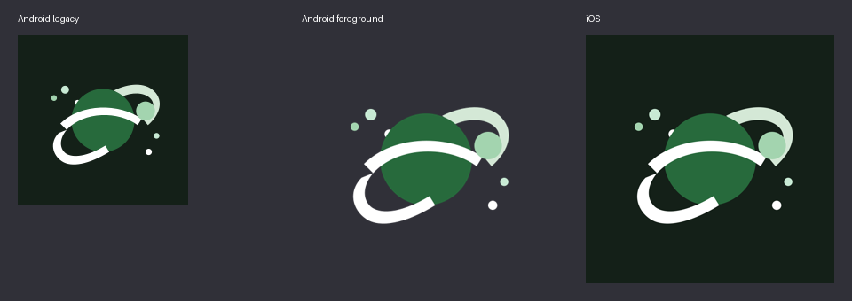
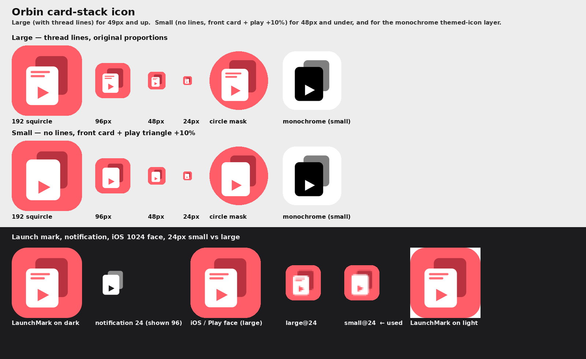

# Launcher icons

Android, iOS, the splash/launch mark, the notification icon and the website
favicon all derive from the card-stack mark in
[`orbin-icon-mark.svg`](assets/orbin-icon-mark.svg) (large, with thread lines)
and [`orbin-icon-mark-small.svg`](assets/orbin-icon-mark-small.svg) (no lines;
front card and play triangle scaled 10%).

The mark is two offset rounded cards on coral `#FF5D68`: a dark-coral
`#B8323F` back card and a white front card with a coral play-triangle notch.
There are no circles, rings, targets or letter O. Exports at 48px and under,
and the Android 13+ monochrome themed-icon layer, use the small mark. Larger
sizes keep the thread lines.

Regenerate with cairosvg and Python Pillow installed:

```sh
python3 scripts/generate_launcher_icons.py
python3 scripts/generate_launcher_icons.py --check
```

The Android adaptive foreground is a 108dp vector. The mark is scaled to sit
inside the central 66dp safe-zone circle (about 31dp radius, with a little
clearance). Both manifest launcher references use that vector and an opaque
coral `#FF5D68` background (`@color/ic_launcher_background`). The monochrome
vector uses the small mark in white, with the play triangle cut out as a hole
so the launcher can apply its themed colors. The Android 12 splash icon
(`windowSplashScreenAnimatedIcon`) points at the same foreground vector with
`ic_launcher_background` behind it, so its white front card stays visible on
the light and dark ReaderTokens splash surfaces.

Legacy square and round PNGs cover 48, 72, 96, 144 and 192px (mdpi uses the
small mark; hdpi and up use the large mark). Square PNGs are opaque; round
PNGs have transparent corners. The legacy and iOS artwork matches the central
72dp adaptive face.

iOS keeps its existing universal 1024px asset-catalog entry (iOS 16 minimum,
iPhone and iPad); Xcode generates the required device sizes. Its PNG is RGB,
opaque and square, with no baked-in rounded corners and no alpha channel. The
LaunchMark images (80 / 160 / 240) are the large mark on a rounded coral tile
with transparent corners, for contrast on both launch-screen surfaces.
No asset-catalog or project setting changes are needed.

The 24dp notification icon (`ic_stat_notify_thread`) is a white silhouette of
the small mark. Functional Android pin-shortcut glyphs (Boards, Downloads,
Feed) stay distinct and are not the app mark.

## Visual review

Before:



After, including both mark versions, common sizes, circle and squircle masks,
monochrome, the launch mark and the notification silhouette:



These are offline previews, not device screenshots. The squircle and iOS masks
are approximations; Android launcher masks, animation and theme palettes vary.
Real launcher rendering, installation/cache refresh, iOS asset compilation and
Apple acceptance must be verified through platform builds and device testing.
The generator's `--check` compares output bytes, so renderer/Pillow version
changes can require review.
