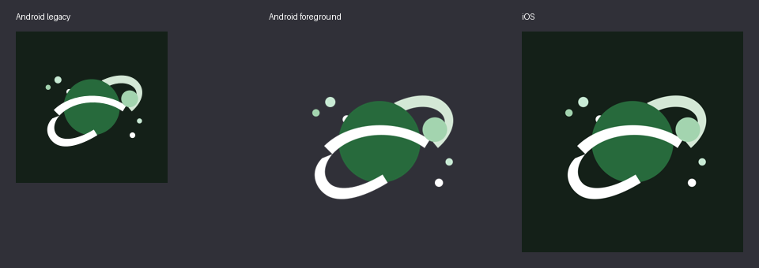
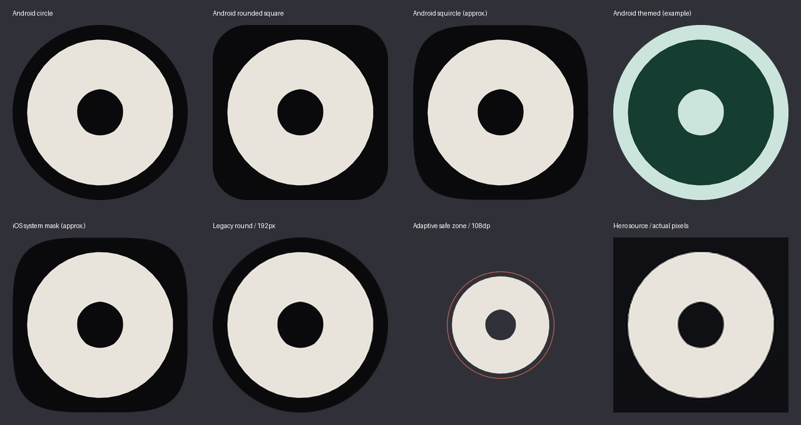

# Launcher icons

Android and iOS use the five original paths in `aperture-mark-vector` from
[`orbin-brand-showcase.svg`](assets/orbin-brand-showcase.svg), the README hero.
Those paths overlap: the rendered mark is a cream ring with a small aperture,
not five separated blades. Preserve the paths rather than substituting a circle
or adding blade gaps. The colors are the hero's Beam (`#E8E4DC`) and Void (`#0A0A0C`).

Regenerate with Inkscape and Python Pillow installed:

```sh
python3 scripts/generate_launcher_icons.py
python3 scripts/generate_launcher_icons.py --check
```

The Android adaptive foreground is a 108dp vector with the original geometry
scaled by 0.3 and translated to (54, 54). Its radius is approximately 30dp,
inside the central 33dp safe-zone radius. Both manifest launcher references use
that vector and an opaque Void background. The monochrome vector uses identical
geometry with white fill so the launcher can apply its themed colors. Obsolete
bitmap adaptive foregrounds are removed. Legacy square and round PNGs cover
48, 72, 96, 144 and 192px; round PNGs have transparent corners.

The legacy and iOS artwork matches the central 72dp adaptive face. iOS keeps
its existing universal 1024px asset-catalog entry (iOS 16 minimum, iPhone and
iPad); Xcode generates the required device sizes. Its PNG is RGB, opaque and
square, with no baked-in rounded corners. No asset-catalog or project setting
changes are needed. This change is limited to launcher assets; the existing
Android and iOS launch-screen artwork is separate.

## Visual review

Before:



After, including common masks, an example themed palette, the safe zone and a
crop of the actual rendered hero:



These are offline previews, not device screenshots. The squircle and iOS masks
are approximations; Android launcher masks, animation and theme palettes vary.
The hero was rendered with Inkscape; its unsupported backdrop-filter and
box-shadow CSS do not affect the aperture geometry. Real launcher rendering,
installation/cache refresh, iOS asset compilation and Apple acceptance must be
verified through platform builds and device testing. The generator's `--check`
compares output bytes, so renderer/Pillow version changes can require review.
